<div align="center">
  
</div>

# entropy-check

> Measure file entropy to flag packed or encrypted artefacts

Part of a red-team tooling collection for **authorised** security testing.

## Install

```bash
git clone https://github.com/amooryx/entropy-check.git
cd entropy-check
```

## Usage

```bash
python entropy_check.py <target>
```

| Flag | Description |
|---|---|
| `-o, --output` | Write results to a file |
| `-v, --verbose` | Verbose output |
| `-y, --yes` | Skip the authorisation prompt |

## Disclaimer

> **Authorised security testing only.** Use this against systems you own or have
> explicit written permission to test. The tool prompts for authorisation before
> acting and is provided for professional engagements, labs, and research.

## Author

**Omar Khalid** — [omareldemery.com](https://omareldemery.com) | [@amooryx](https://github.com/amooryx)

Certifications: OSCP+ · OSCP · CRTP · eWPTX · eCPPT · eCDFP · eCIR · eJPT
